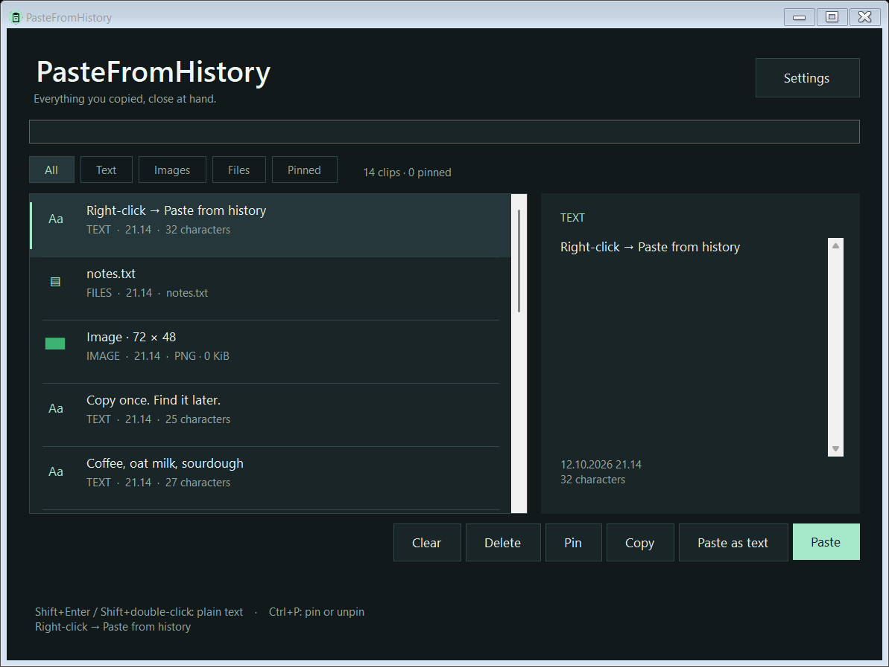

# PasteFromHistory

A local clipboard history app for Windows, with an English interface. Copy text,
images, or files and reuse them from the tray, a keyboard shortcut, or **Paste from history** beside an application's right-click menu.

**Windows x64 · C# / .NET 10 LTS · MIT · No cloud or telemetry**

[User guide](docs/USAGE.md) · [Contributing](CONTRIBUTING.md) ·
[Architecture](docs/ARCHITECTURE.md) · [Release guide](docs/RELEASING.md)



## Get the app

Open [Releases](https://github.com/Resnais-Beefhair/PasteFromHistory/releases/latest) and download
`PasteFromHistory-<version>-win-x64.zip`. Extract it and either:

- Run `PasteFromHistory.exe` directly from a permanent folder.
- Run `Install.cmd` to install for your Windows account and add a Start menu shortcut.

The release includes the .NET runtime. No SDK, separate runtime installation, or
administrator access is required. The ZIP also includes the user guide,
uninstaller, and license notices. GitHub's automatic **Source code** downloads
are for developers and do not contain the EXE.

For a direct download, the release also provides a standalone
`PasteFromHistory-<version>-win-x64.exe` with the runtime included.

The target is Windows 11 x64. Windows 10 22H2 may work, but is not part of the
current manual validation. ARM64 and x86 downloads are not provided. The UI is
in English. Builds are unsigned, so Windows may display an unknown
publisher warning. Release assets include SHA-256 checksums; these detect a
changed download but do not replace code signing.

## Use it

| Action | Result |
| --- | --- |
| Right-click in another app | A **Paste from history** companion button appears near its menu. Choose it, then a clip to paste. |
| Right-click a desktop or Explorer folder | An actual **Paste from history** shell command pastes into that folder. Windows 11 may put it under **Show more options**. |
| Configurable global shortcut | Open history for the current app; enable and choose keys in **Settings > Access**. Default combination: Ctrl+Shift+V. |
| Paste as text / Shift+Enter | Paste a text clip without HTML/RTF formatting. |
| Pin / Ctrl+P | Keep a clip and show it first; use **Pinned** to browse saved snippets. |
| Left-click the tray icon | Browse and search the full history. |
| Right-click the tray icon | Settings, pause capture, clear history, or quit. |

The popup shows **10 clips** by default, pinned first and then recent copies. The
full history retains **100 unpinned clips** by default, plus up to 50 pins. Both
recent-history limits are configurable. Capture starts with new copies after
the app launches; it does not import the Windows Win+V database.

The global shortcut is off by default in new profiles. Enabling it can override
another application's own Ctrl+Shift+V action. Existing saved preferences are
preserved when updating.

In **Settings > Privacy**, exclude apps by executable name, such as `KeePass.exe`.
In **Settings > History**, optionally expire unpinned clips after a number of
days. Expiration is off by default. See the [user guide](docs/USAGE.md) for the
exact capture, pinning, and retention rules.

**The companion is a separate, non-activating window.** It does not inject a menu
item into every application's private menu implementation. Ordinary right-click
behavior is preserved. Native Win32 and Notepad XAML menus have position
handling; custom menus, games, fullscreen windows, and elevated applications can
behave differently. See [compatibility testing](docs/TESTING.md).

The companion uses a global mouse hook while enabled. See
[mouse monitoring](docs/USAGE.md#mouse-monitoring) for what it observes and how to disable it.

## What is stored

- Unicode text and available HTML/RTF formatting.
- Images as PNG, with bitmap compatibility when pasted.
- Copied file and folder paths. Original files must still exist; their contents
  are not backed up in history. Pasting from history copies, rather than repeats a cut.

Explorer pastes create a new TXT or PNG file, or copy files using Windows shell
copy dialogs. Same-named text and image files are not overwritten. Each clip is
limited to 8 MiB and total content to 48 MiB; older unpinned clips are evicted as
needed. Pinned content has its own 16 MiB limit inside that total.
Application-specific clipboard formats are not all preserved.

History is encrypted with current-user Windows DPAPI in
`%LOCALAPPDATA%\Leikehistoria\history.dat`; settings are beside it. This legacy
folder name is retained for compatibility with earlier local builds. Other programs
running as the same Windows user can still access this data. Capture respects
supported privacy markers, but applications do not always mark sensitive data.
Pause capture when needed. See [SECURITY.md](SECURITY.md) for details.

Unreadable history is preserved before new clips are saved. See
[history recovery](docs/USAGE.md#unreadable-history) for recovery file locations
and what happens if the original cannot be moved.

Uninstall with `Uninstall.cmd`. It removes the app's integration and program files,
but preserves history/settings. Clear history in the app first if you want to
remove saved clips. Automatic startup is optional and off by default.

## Build from source

Install Git and the latest stable [.NET 10 SDK](https://dotnet.microsoft.com/download/dotnet/10.0)
on Windows. Clone the repository, then build from its root:

```powershell
git clone https://github.com/Resnais-Beefhair/PasteFromHistory.git
cd PasteFromHistory
```

For a quick development build:

```powershell
dotnet build PasteFromHistory.slnx -c Release
```

To run the regression checks and create the complete release package:

```powershell
powershell -NoProfile -ExecutionPolicy Bypass -File .\scripts\Build.ps1
```

`Build.ps1` runs regression tests, publishes a self-contained EXE, collects the
runtime licenses, creates the ZIP and checksums, and verifies the packaged EXE.
The outputs are `dist/PasteFromHistory-<version>-win-x64.{exe,zip}` and a
`-SHA256SUMS.txt` file. Version numbers come from `Version.props`.

The app has no third-party NuGet application dependencies. The first release
build downloads Microsoft's runtime packs from nuget.org. `global.json` selects
a stable .NET 10 SDK; build outputs and caches stay out of Git.

For development without changing your normal history or Explorer registration:

```powershell
dotnet run --project PasteFromHistory.csproj -- --test-data "$PWD\artifacts\dev-profile"
```

This instance still observes live clipboard changes. See [CONTRIBUTING.md](CONTRIBUTING.md)
for isolated testing, the STA test harness, and the interactive menu regression.

## Project map

| Path | Purpose |
| --- | --- |
| `Core/` | Settings, clip model, limits, and encrypted history storage |
| `Services/` | Clipboard conversion, native Windows calls, paste, and integration |
| `UI/` | History window, settings, companion button, and theme |
| `TrayApplication.cs` | Application lifetime and tray orchestration |
| `tests/` | Regression harness, fixture window, and native-menu tests |
| `scripts/` | Build, verification, installation, and removal |
| `.github/` | Windows CI, draft releases, and contribution templates |

Contributions in English are welcome. Read [CONTRIBUTING.md](CONTRIBUTING.md)
and open an issue or pull request with reproducible steps. Releases and the
project's current limitations are recorded in [CHANGELOG.md](CHANGELOG.md).

## License

[MIT](LICENSE). Bundled runtime components retain their own licenses; see
[THIRD-PARTY-NOTICES.md](THIRD-PARTY-NOTICES.md).
